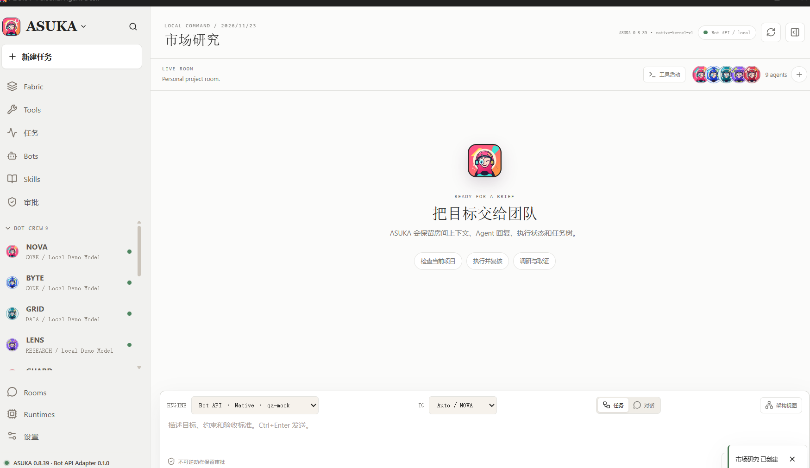

# ASUKA

ASUKA 是一个本地优先的个人 Agent 工作台。它把任务规划、执行、工具调用、独立复核、审批和交付记录放进同一个桌面工作流，并以 Native、Codex、Claude、DSH、OpenMausBot 五种执行适配器连接不同运行时。默认使用 Native，不需要把 Codex 组件嵌入 ASUKA，也不强制依赖 OpenMausBot。

> **当前发布：`0.8.39`。** 仓库只维护当前源码、当前发布说明和推荐环境，不提交历史安装包、运行数据或密钥。`0.8.38` 便携版仅保留在本地 E 盘备份，不随本次仓库更新发布。详见 [CHANGELOG.md](CHANGELOG.md)。

### 客户端界面



ASUKA 桌面客户端把房间、Bot 编队、执行状态、任务输入和审批边界放在同一个工作界面中。用户可以从左侧切换任务、Bot、Skill、工具与审批，在中央房间下达目标，并从顶部和任务卡片确认当前构建版本、执行者与交付状态。截图使用本地演示模型，不包含真实密钥或客户数据。

## 中文说明

### 当前可实现的功能

- **本地优先桌面工作台**：任务、消息、运行事件、工具审计和审批保存在本地 SQLite；桌面版密钥通过系统凭据保护，不写入浏览器存储。
- **每个 Bot 有独立 Agent Kernel**：参与任务的 Bot 拥有按任务和角色隔离的持久线程、受限工具循环、上下文压缩、事件账本和中断恢复记录。这里实现的是可观察、可恢复的 Agent 工作流，不是复制模型的隐藏思考过程。
- **NOVA 单主执行编排**：NOVA 只负责分类、选人和验收流程，不替代执行者。每个任务只有一个主执行者；专业 Bot 提交有长度限制的结构化贡献，不能抢占执行权、并发改同一工作区或自行发起浏览器会话。
- **Reviewer 独立复核**：执行结果、团队贡献和工具证据交给独立 Reviewer；复核失败时明确降级，不把未经审核的结果标成 PASS。
- **模型与运行时可选**：Native 支持 OpenAI-compatible 和 Anthropic 协议；Codex、Claude、DSH 使用本机既有 CLI 登录；OpenMausBot 作为显式兼容模式存在，不可用时不会静默替换。
- **Skills、MCP 与 Computer Use**：按需加载 `SKILL.md` 和引用文件；可调用本地或远程 MCP；状态变更工具、GUI 动作和敏感操作保留任务级审批。
- **任务过程可见**：任务 Fabric、Mission Control、交付物索引和 Archify 架构视图共同展示决策、执行、复核、交付及审批状态；界面会显示构建版本、唯一主执行者、贡献者和 Reviewer 状态。
- **浏览器研究证据**：复用任务级浏览器会话，限制研究证据的页面和来源覆盖，避免重复申请会话或把单一页面当成充分证据。

### 未来团队包：CAD、CNC 与 Design

ASUKA 后续计划支持 **Team Packs（团队包）**。团队包类似 Skill，但交付单位不是一个提示词或一个脚本，而是一支已经配置好角色、技能、工具权限、交付物和验收门的 Bot 团队。用户选择团队包后，NOVA 可以快速装载对应成员，让团队直接接手某类任务。

设计判断：通用大模型通常具备较强的推理和生成能力，却缺少一项专业任务真正需要的上下文：谁负责什么、先做什么、哪些工具能碰、输入资料按什么口径解释、什么结果算完成、失败时向谁升级。团队包不是重新训练模型，也不是宣称模型突然具备专业资格，而是把这些“工作制度”封装成可安装、可版本化、可评估的协作结构。它把提示工程提升为团队设计，可能显著降低通用模型进入 CAD、CNC、设计等专业流程时的冷启动成本和提示漂移。

一个成熟团队包应同时包含：清晰的任务入口与输入契约、角色拓扑与唯一主执行者、Skill 绑定、上下文分层、工具与权限清单、交付物模板、阻断审批门、可复现验收样例和人类升级路径。它还应记录适用版本、依赖工具、许可证、数据保密边界和已知失效条件。这样社区贡献的不仅是“更长的提示词”，而是一份可检查、可组合、可持续维护的专业工作单元。若这一模型成立，未来的通用模型可以像安装专业团队一样快速接手任务，而不必为每个垂直领域重新训练一个专用模型。

计划中的首批方向包括 CAD 参数化建模与图纸检查、CNC 工艺与刀具路径复核、工业设计和产品设计评审。团队包会明确所需 Skill、MCP/CAD 工具、输入资料、审批点、输出格式和验收标准，并继续遵守单主执行、独立复核和最小权限原则。该能力目前是**路线图**，尚未作为已发布功能提供。详见 [docs/team-packs.md](docs/team-packs.md)。

### 一般用户如何开始

1. 在 Windows x64 电脑上解压或运行当前便携版 `ASUKA-0.8.39-portable.exe`，默认把用户数据放在 `E:\ASUKA\data\user-data`（可用环境变量覆盖）。
2. 打开 **设置 → 本地模型执行**，选择 OpenAI-compatible 或 Anthropic，填写 Base URL、模型 ID 和 API Key，测试后保存并启用 Native。
3. 回到 **ASUKA Command**，保持 `ENGINE = Native`，输入目标、约束和验收标准；不可逆工具会停在审批卡，不会自动执行。
4. 在任务详情查看主执行者、贡献者、Reviewer 和交付物。需要浏览器或本机技能时，先在 Tools/Skills 中确认权限和可用状态。
5. 便携版无需安装 Node.js；需要随包加载的模型 API、CLI 适配器和外部 MCP 仍由使用者自行配置。

### 开发者如何开始

```powershell
git clone https://github.com/mtj5576-tech/ASUKA.git
cd ASUKA
npm install
npm test
npm run dev
```

开发预览默认打开 `http://127.0.0.1:5173`。生产构建使用 `npm run build`，桌面开发使用 `npm run desktop`，Windows 便携包使用 `npm run desktop:dist`。Native 执行、策略、工具和存储分别位于 `server/native/`、`server/kernel/`、`server/tools/`；共享决策契约位于 `shared/decision/`。

### 推荐环境

| 项目 | 建议配置 |
| --- | --- |
| 操作系统 | Windows 11 x64；Windows 10 22H2 x64 也可用于便携版 |
| 便携客户端 | 无需单独安装 Node.js；首次启动预留约 2 GB 磁盘 |
| 源码开发 | Node.js 22.12+（建议使用当前 LTS）；npm；Git |
| 硬件 | 8 GB 内存起，16 GB 更适合本地 MCP、浏览器和多 Bot 任务 |
| 网络 | 仅在调用外部模型 API、浏览器研究或远程 MCP 时需要 |
| 凭据 | 使用 ASUKA 加密存储或本机既有 CLI 登录；不要把密钥提交到仓库 |

### 社区协作

欢迎开发者、设计师、工程师和普通用户提交 Issue、复现步骤、文档修订、Skill、团队包草案、适配器或代码改进。提交前请保持改动聚焦、说明验证方式、避免提交密钥/用户数据/历史安装包，并优先复用已有标准和成熟工具。涉及 CAD、CNC、工业设计的工作流可以直接在 Issue 中提出输入格式、审批点和验收样例，供未来 Team Pack 设计使用。

## English overview

ASUKA is a local-first personal agent desk for planning, executing, reviewing and delivering work with a visible audit trail. It supports five execution adapters: Native, Codex, Claude, DSH and the optional OpenMausBot compatibility layer. Native is the default and does not require embedding Codex or running OpenMausBot.

> **Current release: `0.8.39`.** This repository keeps current source, current release notes and the recommended environment. Historical installers, runtime data and secrets are not committed. The `0.8.38` portable build remains in a local E-drive backup only. See [CHANGELOG.md](CHANGELOG.md).

### Client interface


The ASUKA desktop client keeps the room, Bot crew, execution state, task composer and approval boundary in one operational surface. The left rail provides task, Bot, Skill, Tool and approval navigation; the center room is where users submit a brief; the header and task cards expose build identity, ownership and delivery state. The screenshot uses a local demo model and contains no real credentials or customer data.

### Implemented capabilities

- Local SQLite persistence for tasks, messages, events, tool evidence and approvals; desktop secrets use the OS credential store.
- A persistent Node Agent Kernel per participating Bot, with bounded model/tool rounds, role policy, context compaction, event ledger and interrupted-thread recovery. This reproduces an observable agent workflow, not hidden model reasoning.
- Deterministic NOVA orchestration with exactly one primary worker, advisory-only specialist contracts, independent Reviewer gates and explicit degraded outcomes.
- OpenAI-compatible and Anthropic providers, host-authenticated Codex/Claude/DSH adapters, and explicit OpenMausBot compatibility with no silent fallback.
- Progressive-disclosure Skills, local and remote MCP tools, browser evidence collection, Computer Use policy and task-scoped approvals for state-changing actions.
- Task Fabric, Mission Control, artifact indexing, architecture visualization, build identity and ownership views for primary worker, contributors and reviewer state.

### Team Packs roadmap

Team Packs are planned as a higher-level counterpart to Skills. A Skill packages instructions and resources; a Team Pack packages a working Bot team with named roles, required Skills, tools and permissions, input contracts, deliverables, approval gates and acceptance criteria. Selecting a Team Pack should let NOVA assemble the team and take over a class of tasks quickly. Planned domains include CAD modeling and drawing review, CNC process and toolpath validation, and industrial/product design review. Team Packs are a **roadmap item**, not a shipped feature. See [docs/team-packs.md](docs/team-packs.md).

Design thesis: general-purpose models are increasingly capable at reasoning and generation, but professional work also depends on organizational context: who owns which decision, what must happen first, which tools may be used, how input data should be interpreted, what counts as complete, and when to escalate to a human. A Team Pack does not retrain the model or claim that a general model is automatically professionally qualified. It packages the operating system of a team: role topology, context contracts, skill bindings, tool grants, artifact templates, blocking review gates, reproducible acceptance samples and escalation paths. This may reduce cold-start cost and prompt drift when a general model enters a specialized workflow.

A mature Team Pack should be installable, versioned, inspectable and testable. It should also state tool versions, licenses, confidentiality boundaries and known failure conditions. The hypothesis is that this “organization layer” can become a faster path to professional task handoff than training a separate vertical model for every domain. If it works, a general model can take over a new class of work by loading a well-designed team, much like installing a professional operating unit. Community contributions should therefore be evaluated as workflow packages, not merely as longer prompts.

### Getting started

For end users, run `ASUKA-0.8.39-portable.exe`, configure a Native provider under **设置 → 本地模型执行**, keep `ENGINE = Native`, and submit a scoped task with explicit constraints and acceptance criteria. Inspect the primary worker, bounded contributions, Reviewer verdict and deliverable cards before trusting a result. The portable app does not require Node.js on the target machine.

For developers, install Node.js 22.12+ (current LTS recommended), run `npm install`, `npm test`, `npm run dev`, and use `npm run desktop:dist` for the Windows portable target. See the existing technical sections below for adapter, MCP, decision, kernel and desktop details.

### Recommended environment

Windows 11 x64 is recommended; Windows 10 22H2 x64 is also suitable for the portable build. Use at least 8 GB RAM (16 GB recommended for combined browser, MCP and multi-Bot work), reserve roughly 2 GB of disk, and provide a current Node.js 22.12+ toolchain only when building from source. Network access is needed only for external model APIs, browser research and remote MCP services. Never commit API keys, local data, release binaries or historical installers.

### Community

Contributions are welcome: bug reports with reproductions, documentation fixes, Skills, Team Pack drafts, adapters, tests and workflow improvements. Keep pull requests focused, document validation, reuse mature standards and tools where practical, and do not include secrets, user data or legacy installers. Suggestions for CAD, CNC and design workflows are especially useful when they include concrete file formats, approval points and acceptance examples.

## Implementation reference

## Run

```powershell
npm install
npm run dev
```

Open `http://127.0.0.1:5173`.

The Vite dev server proxies `/omb` to `http://127.0.0.1:8799`. Set `OMB_URL` for the production proxy if OpenMausBot listens elsewhere.

The client can switch or auto-discover the OpenMausBot address from **设置**. The local proxy accepts `8799`, `18799`, and `28799` during discovery and applies the selected address to subsequent API requests.

Provider setup is available in **设置 → 接入模型 API**. The wizard tests a key with OpenMausBot, saves it through `PUT /api/config`, and refreshes the corresponding model catalog. The key is sent only to OpenMausBot and is never written to browser storage.

Native setup is available in **设置 → 本地模型执行**. Saving a Native Provider keeps the key out of the renderer; the desktop client encrypts it with Windows credential protection. Enabling Native makes tasks run without an OpenMausBot process.

Built-in platform presets include OpenAI, Anthropic, OpenRouter, xAI, Mistral, Groq, Cerebras, Greenference, ModelGo, Meta, DeepSeek, Qwen/DashScope, Z.ai/GLM, Moonshot/Kimi, and a custom OpenAI-compatible endpoint. Compatible presets create separate endpoint instances, so one platform does not overwrite another.

## Native first use

1. Open **设置 → 本地模型执行**.
2. Select `OpenAI-compatible` or `Anthropic`, enter Base URL, model ID and API key.
3. Test the connection, save, then select **启用 Native**.
4. Open **指挥台**, keep `ENGINE = Native`, and submit a research or API-only task.
5. Native Adapter routes through NOVA, chooses one primary worker, collects bounded Worker Contracts and sends the result plus tool evidence to an independent Reviewer. The primary worker can call enabled local MCP tools; state-changing calls and Computer Use actions pause for one-time approval. Results, streams, tool transcripts and approvals stay in local SQLite.

Native uses deterministic orchestration rather than free-form Bot discussion: NOVA is not a worker, only one Bot owns the final deliverable at a time, and specialist contributions cannot block the primary worker. See [docs/multi-agent-workflow.md](docs/multi-agent-workflow.md) and [docs/native-adapter.md](docs/native-adapter.md).

Skills use Codex-compatible progressive disclosure. ASUKA discovers each `SKILL.md` automatically, exposes `skill_list`, `skill_read` and `skill_run`, and loads references or scripts only when the selected workflow needs them. See [docs/skill-runtime.md](docs/skill-runtime.md).

Task-generated files are indexed by path and shown as clickable deliverable cards in the room conversation and task detail view, regardless of file type. See [docs/artifacts.md](docs/artifacts.md).

ASUKA ships with a global Native skill library under `skills/`. The bundled skills are enabled for every bot by default, and their enabled state is shared across bots. The executor receives a compact catalog on every task and loads the full `SKILL.md` body when the user names a skill explicitly.

## Coding Agent adapters

ASUKA detects `codex`, `claude` and `dsh` from PATH. Available agents can be selected in **设置 → Adapter Registry** or directly from the composer `ENGINE` menu.

- Codex uses `codex exec --json` with the existing Codex host login.
- Claude uses `claude -p --output-format stream-json` when its CLI is installed.
- DSH uses `dsh headless` with the existing DSH profile.

Set `ASUKA_WORKSPACE` to the project directory the local coding adapters should inspect. Codex runs read-only in this registry slice. See [docs/adapter-registry.md](docs/adapter-registry.md).

## OpenMausBot compatibility

1. Start OpenMausBot only when its broader runtime, Skills or MCP compatibility is needed.
2. In **设置 → Adapter Registry**, explicitly choose **OpenMausBot Adapter**.
3. ASUKA creates a separate `ASUKA` section, three agents using available runtimes, and the `ASUKA Command` room.
4. Dispatch a task from the room composer.

The UI exposes unavailable adapters without silently substituting them. Configure Native keys in ASUKA, use the existing host login for coding CLIs, or explicitly select OpenMausBot when its downstream runtime credentials are required.

## Integration boundary

- ASUKA Core owns adapter selection, authentication state and credential routing. Native keys are held in the ASUKA encrypted store, coding adapters reference host CLI authentication, and the OpenMausBot adapter delegates only its downstream runtime credentials to OpenMausBot.
- Codex runs through `codex exec --json`; Claude and DSH use their corresponding local CLI contracts.
- The UI reads its snapshot, task details, task actions, and Agent edits through ASUKA Core. The selected adapter owns those operations.
- OpenMausBot-specific HTTP is confined to `server/core/openmausbot-adapter.mjs`; Native execution is confined to `server/native/`; MCP transport and tool policy live under `server/tools/`; CLI adapters live under `server/adapters/`. All expose the same normalized Core contract.
- ASUKA also keeps a local OpenMausBot HTTP proxy for provider and skill operations not yet normalized by Core. Its MCP server can be used by external MCP clients, but the browser UI cannot launch a stdio MCP process directly.
- OpenMausBot approval cards are written back through `POST /api/threads/:id/respond`. Native approval cards are resolved in local SQLite through the same ASUKA approval UI.

## Production build

```powershell
npm run build
npm start
```

The production server listens on `http://127.0.0.1:4173` by default and proxies `/omb` to the local OpenMausBot API.

## Desktop client

```powershell
npm run desktop
```

This builds the web client and opens it in Electron. The desktop process starts its own local proxy on an available loopback port, so it does not conflict with the browser build on `4173`.

The connection screen can also launch OpenMausBot when it is not already running. It checks `OPENMAUSBOT_APP`, the standard per-user Windows install locations, and `OPENMAUSBOT_SOURCE` or `E:\grok` source checkouts with an Electron launcher.

Build a Windows portable executable with:

```powershell
npm run desktop:dist
```

The current local build output is `release/ASUKA-0.8.39-portable.exe`. Run `Start-ASUKA.cmd` from the E-drive installation to keep using `E:\ASUKA\data\user-data`; the Core reports its build version at `GET /__asuka/core/build`. Native and coding adapters run without OpenMausBot.

## P0 operations

- Edit an Agent's name, responsibilities, instructions, Runtime, model, approval level, and ASUKA room membership.
- Open the task inbox to inspect job state, stop a running task, retry the latest user request, or continue the task with another message.
- Configure OpenAI, Anthropic, OpenRouter, or an OpenAI-compatible endpoint from the desktop client.
- Start or reconnect OpenMausBot from the connection screen without editing configuration files.

## Decision Core

Decision Core v1 is frozen in `shared/decision/contracts.mjs`. It provides deterministic task classification, scale/risk scoring, compact team selection, capability-gap detection, workflow ordering, evaluation gates, approvals, stop conditions, and budgets. See [docs/decision-core.md](docs/decision-core.md).

## Native Adapter

Native Adapter implements OpenAI-compatible and Anthropic streaming, MCP tool calling, SQLite conversation and event storage, NOVA routing, one primary worker, bounded Worker Contracts, one independent Reviewer, stop, retry, task-bound approvals, output continuation and interrupted-task recovery. It uses `x-asuka-adapter: native` on the same ASUKA Core routes. See [docs/native-adapter.md](docs/native-adapter.md).

Native also includes an internal Node Agent Kernel. Each participating Bot gets a persistent thread, bounded tool loop, role policy, context compaction, tool evidence and kernel events without launching Codex components. See [docs/node-agent-kernel.md](docs/node-agent-kernel.md).

## Adapter Registry

The final registry is `NativeAdapter`, `CodexAdapter`, `ClaudeAdapter`, `DSHAdapter` and `OpenMausBotAdapter`. `GET /__asuka/core/adapters` reports availability and versions. Requests default to Native and never fall back to OpenMausBot implicitly. See [docs/adapter-registry.md](docs/adapter-registry.md).

## Task Fabric

ASUKA tasks now persist an immutable Mandate, a structured executor Report and a deterministic Ticket Stage. The Fabric view groups tasks into Human Attention, Working, Queued, Idle and Ended, with retry and stop controls. This contract is adapted from dsh-superagent without embedding DSH or Cordis. See [docs/task-fabric.md](docs/task-fabric.md).

## Mission Control

The command room now displays a live decision workflow derived from the real TeamPlan: decision/architecture, grouped execution, review/security and delivery. Each group can be opened to inspect assigned roles, deliverables, gates and execution events. While a Native task runs, the composer switches to guidance mode and feeds user direction into the next execution stage without bypassing approvals. See [docs/mission-control.md](docs/mission-control.md).

## Room visualization

ASUKA Command includes an embedded Archify architecture view built from the current room, bots, tasks, projects, skills, tools and approval gates. The generated artifact is self-contained HTML rendered by the vendored Archify 3.2.0 engine under `vendor/archify/` (upstream commit `44781293f38728baf04dbad33ce1a0cef8c39cca`, Apache-2.0). The `架构视图` button switches between the live diagram and the room conversation.

## MCP and Computer Use

The Tools view connects local stdio and remote HTTPS MCP servers, discovers tools, resources and prompts, and exposes a JSON argument console with local audit. A GitHub PAT preset targets GitHub's hosted MCP endpoint. Native Agent tasks automatically receive the enabled MCP tool catalog. Read-only tools can run directly; state-changing tools require a task-scoped one-time approval bound to the exact arguments. If Windows-MCP is installed, Computer Use requires an observation before an action and automatically captures a fresh Snapshot after each GUI action. See [docs/computer-use-and-mcp.md](docs/computer-use-and-mcp.md).

## Native settings

Settings is now a dedicated ASUKA console with searchable navigation for general behavior, appearance, permissions, storage, models, connectors, Computer Use, browser policy, personalization, Git and advanced capability status. Preferences persist in `<dataDir>/asuka-settings.json`; only implemented controls are presented as active. See [docs/settings.md](docs/settings.md).
